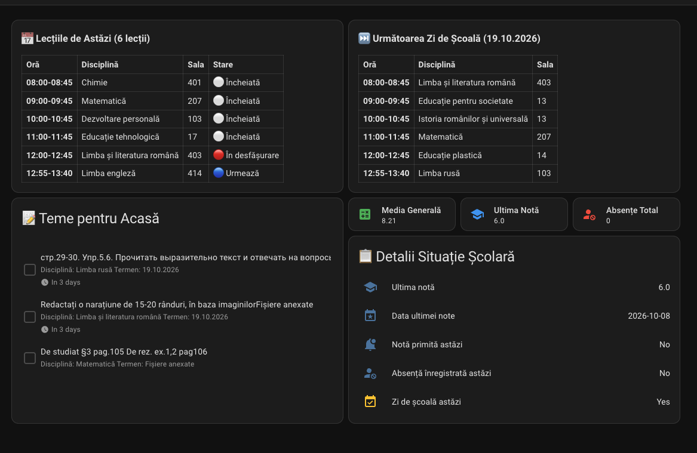

# Agenda SIME MD — Home Assistant Integration

<p align="center">
  
</p>

<p align="center">
  <strong>Integrare Home Assistant (HACS) pentru Catalogul Electronic Școlar din Republica Moldova (<a href="https://agenda.sime.md">agenda.sime.md</a>).</strong>
</p>

<p align="center">
  <a href="https://github.com/hacs/default"></a>
  <a href="https://github.com/prescornic/ha-agenda-sime-md/actions/workflows/validate.yml"></a>
  <a href="https://opensource.org/licenses/MIT"></a>
</p>

<p align="center">
  
</p>

---

## 🌟 Funcționalități Principale (Key Features)

Această integrare aduce catalogul școlar SIME direct în tabloul de bord Home Assistant pentru părinți și elevi:

- 📊 **Note & Medii în Timp Real (Grades & Averages):**
  - **Ultima notă** (`sensor.<elev>_latest_grade`), extrasă din *Performanță -> Note recente* (`P1_LAST_3_EVAL_LIST`) pentru detectarea promptă a calificativelor noi, cu atribute bogate (disciplină, dată, profesor, temă).
  - **Media generală** (`sensor.<elev>_general_average`) calculată automat din mediile semestriale.
  - **Medii pe discipline** (`sensor.<elev>_<disciplina>_average`) create dinamic pentru fiecare materie din catalog.
- 🚨 **Absențe & Alerte Instantanee (Attendance & Live Alerts):**
  - Contor total absențe (`sensor.<elev>_absences`) cu clasificare motivate / nemotivate în atribute.
  - Senzor binar `binary_sensor.<elev>_absence_today`: se activează instant (`on`) dacă este înregistrată o absență în ziua curentă (ideal pentru alerte mobile urgente).
  - Senzor binar `binary_sensor.<elev>_new_grade_today`: notifică automat apariția unei note primite astăzi.
- 📅 **Orar & Teme de Lecții cu Colorare Dinamică (Schedule & Lesson Themes):**
  - Senzori `sensor.<elev>_today_lessons` și `sensor.<elev>_next_day_lessons` cu lista orelor și temele lecțiilor (*temele lecțiilor*) extrase din Agenda SIME (vizualizarea „Zi”).
  - Colorare dinamică a stării orelor:
    - 🔴 **Roșu**: Lecția curentă (în desfășurare acum).
    - 🔵 **Albastru**: Lecțiile următoare (urmează mai târziu astăzi).
    - ⚪ **Gri**: Lecțiile încheiate anterior astăzi.
  - Salt automat peste weekenduri și vacanțe pentru afișarea următoarei zile active de școală.
  - Calendar nativ HA (`calendar.<elev>_timetable`).
- 📝 **Teme pentru Acasă (Homework To-Do):**
  - Listă nativă HA To-Do (`todo.<elev>_homework`) cu sarcinile active, descrierile și datele limită.
- ⚡ **Sondare Inteligentă & Adaptivă (Adaptive Polling):**
  - **Ziua (07:00 – 19:00):** Actualizare frecventă (implicit 15 minute, configurabil) pentru detectarea rapidă a notelor și absențelor în timpul orelor de curs.
  - **Noaptea (19:00 – 07:00):** Actualizare relaxată (1 oră) pentru economisirea resurselor.
- 👨‍👩‍👧‍👦 **Suport Conturi Părinte & Elev:**
  - Suportă atât conturi de **Părinte** (cu selectarea automată a elevilor înrolați), cât și conturi de **Elev**.
  - Grupare automată a tuturor entităților per elev sub un dispozitiv unificat în Device Registry.

---

## 📦 Instalare (Installation)

### Prin HACS (Recomandat)
1. Asigurați-vă că aveți instalat [HACS](https://hacs.xyz/).
2. În Home Assistant, navigați la **HACS** > **Integrări**.
3. Apăsați pe meniul cu trei puncte din colțul dreapta-sus > **Depozite personalizate (Custom repositories)**.
4. Adăugați URL-ul: `https://github.com/prescornic/ha-agenda-sime-md` cu categoria **Integration**.
5. Căutați **Agenda SIME MD**, apăsați **Descărcare (Download)** și reporniți Home Assistant.

### Instalare Manuală
1. Descărcați arhiva repository-ului.
2. Copiați directorul `custom_components/agenda_sime_md` în `/config/custom_components/agenda_sime_md/` din instalarea Home Assistant.
3. Reporniți Home Assistant.

---

## ⚙️ Configurare (Configuration)

1. În Home Assistant, mergeți la **Setări** > **Dispozitive și servicii** > **Adăugare integrare**.
2. Căutați **Agenda SIME MD**.
3. Introduceți **Numele de utilizator** și **Parola** de pe [agenda.sime.md](https://agenda.sime.md).
4. Selectați tipul contului (**Părinte** sau **Elev**).
5. Dacă utilizați un cont de părinte cu mai mulți copii, selectați elevul/elevii pe care doriți să îi monitorizați.
6. Opțional, ajustați intervalul de actualizare pe timp de zi și orele de școală din meniul **Opțiuni** al integrării.

---

## 📱 Exemple de Carduri Lovelace (Dashboard Cards)

Configurațiile YAML complete sunt disponibile în [examples/dashboard_cards.yaml](examples/dashboard_cards.yaml).

### 1. Card Orar & Teme Lecții (cu stare colorată dinamic)
Card Markdown ce evidențiază automat ora curentă (🔴 roșu), orele viitoare (🔵 albastru), orele trecute (⚪ gri) și afișează temele lecțiilor pentru astăzi și următoarea zi de școală:

```yaml
type: markdown
title: "📚 Orar & Teme Lecții"
content: >
  
  
  

  ### 📅 Lecțiile de Astăzi ({{ states('sensor.elev_today_lessons') }} lecții)
  
    | Oră | Disciplină | Sala | Temă / Subiect | Stare |
    | :--- | :--- | :--- | :--- | :--- |
    
      {% set start = as_datetime(l.start_time).strftime('%H:%M') if l.start_time else '--:--' %}
      {% set end = as_datetime(l.end_time).strftime('%H:%M') if l.end_time else '--:--' %}
      
        
      
        
      
        
      
      | **{{ start }}-{{ end }}** | {{ l.subject }} | {{ l.classroom or '-' }} | *{{ l.topic or '-' }}* | {{ status_badge }} |
    
  
    *Nu sunt lecții programate pentru astăzi.*
  

  ---

  ### ⏭️ Următoarea Zi de Școală ({{ as_datetime(next_date).strftime('%d.%m.%Y') }}—)
  
    | Oră | Disciplină | Sala | Temă / Subiect |
    | :--- | :--- | :--- | :--- |
    
      {% set start = as_datetime(l.start_time).strftime('%H:%M') if l.start_time else '--:--' %}
      {% set end = as_datetime(l.end_time).strftime('%H:%M') if l.end_time else '--:--' %}
      | **{{ start }}-{{ end }}** | {{ l.subject }} | {{ l.classroom or '-' }} | *{{ l.topic or '-' }}* |
    
  
    *Nu sunt date disponibile pentru următoarea zi de școală.*
  
```

### 2. Card Situație Academică & Absențe
```yaml
type: vertical-stack
cards:
  - type: grid
    columns: 3
    square: false
    cards:
      - type: tile
        entity: sensor.elev_general_average
        name: "Media Generală"
        icon: mdi:calculator-variant
        color: green
      - type: tile
        entity: sensor.elev_last_grade
        name: "Ultima Notă"
        icon: mdi:school
        color: blue
      - type: tile
        entity: sensor.elev_absences
        name: "Absențe Total"
        icon: mdi:account-cancel
        color: red
  - type: entities
    title: "📋 Detalii Situație Școlară"
    entities:
      - entity: sensor.elev_latest_grade
        name: "Ultima notă"
      - entity: sensor.elev_latest_grade_date
        name: "Data ultimei note"
      - entity: binary_sensor.elev_new_grade_today
        name: "Notă primită astăzi"
      - entity: binary_sensor.elev_absence_today
        name: "Absență înregistrată astăzi"
      - entity: binary_sensor.elev_school_day
        name: "Zi de școală astăzi"
```

### 3. Card Teme pentru Acasă
Card nativ Home Assistant conectat la lista de teme:
```yaml
type: todo-list
entity: todo.elev_homework
title: "📝 Teme pentru Acasă"
```

---

## 🔔 Exemple de Automatizări (Automations)

Fișierul cu rețete gata de importat este în [examples/automations.yaml](examples/automations.yaml).

### Alertă instantanee pentru absență înregistrată astăzi
```yaml
alias: "SIME MD: Alertă absență astăzi"
trigger:
  - platform: state
    entity_id: binary_sensor.elev_absence_today
    to: "on"
action:
  - service: notify.notify
    data:
      title: "⚠️ Alertă Școlară: Absență Consemnată"
      message: >
        A fost înregistrată o nouă absență în catalogul electronic astăzi!
        Total absențe în semestru: {{ states('sensor.elev_absences') }}.
```

### Notificare când se înregistrează o notă nouă
```yaml
alias: "SIME MD: Notificare notă nouă"
trigger:
  - platform: state
    entity_id: sensor.elev_latest_grade
condition:
  - condition: template
    value_template: "{{ trigger.to_state.state not in ['unknown', 'unavailable', ''] }}"
action:
  - service: notify.notify
    data:
      title: "🎓 Notă nouă: {{ trigger.to_state.state }}"
      message: >
        Disciplina: {{ trigger.to_state.attributes.subject }}
        Data: {{ trigger.to_state.attributes.date }}
        Profesor: {{ trigger.to_state.attributes.teacher }}
        Media generală curentă: {{ states('sensor.elev_general_average') }}
```

---

## 🏛️ Arhitectură & Decuplare (Architecture)

Codul este structurat modular:
- `custom_components/agenda_sime_md/agenda_sime_md/`: Nucleul asincron pur în Python (`aiohttp`), complet decuplat de Home Assistant (zero dependențe HA), pregătit pentru publicare pe PyPI (`agenda-sime-md-py`).
- `custom_components/agenda_sime_md/`: Componenta oficială Home Assistant cu coordinator adaptiv, config flow, senzori, calendare și to-do list.

---

## 📄 Licență (License)

Acest proiect este licențiat sub licența MIT — consultați fișierul [LICENSE](LICENSE) pentru detalii.
